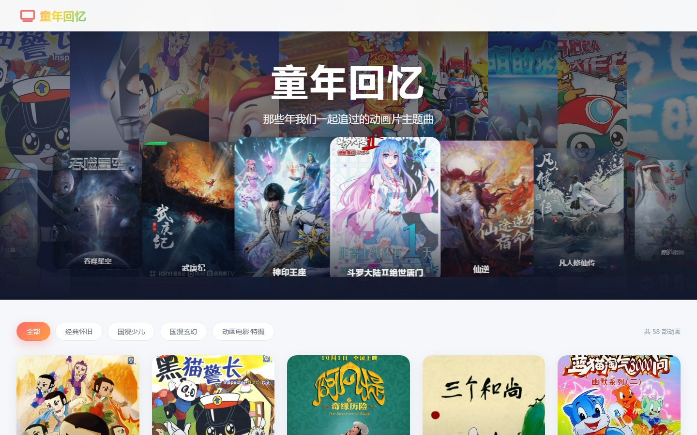

# 童年回忆 · 动画主题馆



一个零依赖的单文件静态站：**58 部国产动画**的卡片墙，鼠标悬停时卡片封面直接被 B 站主题曲视频顶替；
顶部是一条自动横向滚动的海报带，悬停停住并试听该片主题曲，点击进对应子页面。

线上地址：<https://dayword.github.io/blog/>

## 站点能力

- **卡片墙**：按 `经典怀旧 / 国漫少儿 / 国漫玄幻 / 动画电影·特摄` 分组筛选。
  悬停卡片 → 封面换成 B 站主题曲视频（海报的模糊放大版垫底，不留黑边）；移开即收走。
- **滚动海报带**：自动滚动；悬停停住并试听主题曲（描红边 + `♪`）；按住左键可拖动；点击进子页面。
- **子页面左侧目录**：58 部动画按四组列出（缩小版封面 + 名称，200px 宽），
  顶部按钮可收成 76px 的纯封面条（状态记在本机）；点任意一条直接跳到那一部，当前这部高亮。
  窄屏（≤820px）改成抽屉：左下角悬浮按钮打开、点遮罩关闭、选完自动收起。
- **子页面**（`#/a/<id>`）：顶部是一整块 **hero** —— 名称与引子居中放在最上面，
  下面是一台**铺满整宽的 3D 海报轮播**（定高 300px）：
  中间那张 500×300 横版大图，左右两张 150×200 竖版、落在两侧 20% 带的正中，
  并向内侧倾斜（左卡的左边缘、右卡的右边缘一起往屏幕里凹，左右互为镜像）。
  海报是竖版、中间卡是横版框，所以卡片里垫一层同海报的**模糊放大版**，
  上面再放完整清晰的海报 —— 不裁切、不留黑边；
  自动缓慢翻页、鼠标停上去就停住、两侧圆形箭头可手动翻。
  hero 的底衬是这部动画**自己的真实封面**：有几张海报就把整条背景等分成几份，
  每份铺一张、透明度 `0.7`，上面再压一层浅渐变遮罩（在保证白字可读的前提下尽量亮）。
  再往下是**每部 5 个视频源**（主题曲 / 正片合集 / 解说回顾，带切换按钮；长按按钮可拖动换顺序，顺序记得住，排在第一个的就是进页自动播的那个）、
  主题曲歌单、讲解长文。
  歌单里**每条主题曲都带一条进度条**：点一下跳到该处，按住可左右拖；拖的不是当前这首时会先切歌、
  等时长就绪再落到目标位置。播放顺序仍是长按条目拖动调整（顺序记得住）；同一部里歌名不重复。
- 零构建、零依赖、无后端。数据全部内联在 HTML 里，所以 `file://` 双击也能跑
  （B 站视频需要联网）。

## 目录结构

```
blog/
├── index.html                    # 站点全部内容（单文件，数据内联）
├── preview.jpg                   # README 预览图
├── assets/
│   ├── nav/pNN.jpg               # 58 张侧栏缩略图（152×200，共约 0.5 MB）
│   ├── posters/p01..p58/NN.jpg   # 358 张动画海报（每部至少 5 张，已查重）
│   └── audio/pNN_N.mp3           # 256 首主题曲（每部 2~5 首，同片歌名不重复，约 669 MB）
└── .github/workflows/pages.yml   # 推 main 自动部署到 GitHub Pages
```

## 本地预览

`file://` 直接双击 `index.html` 即可（数据内联，没有 fetch）。
若想看 B 站视频，起个本地服务更稳：

```bash
python -m http.server 8000
# 然后打开 http://localhost:8000
```

## 重新生成 / 改成自己的版本

生成逻辑封装在 WorkBuddy 技能 `childhood-memories-site` 里：

```bash
# 拉素材（423 个文件 / 约 352 MB，已存在的会跳过）
python scripts/fetch_assets.py --out ./childhood-memories
# 渲染单文件页面
python scripts/build_site.py  --out ./childhood-memories
# 推回 GitHub
python scripts/publish.py --repo Dayword/blog --dir ./childhood-memories
```

想换片单（换成别的动画、电影、游戏）：改写 `references/site_data.json` 里的
`DATA` / `STORY` / `THEME`，按同样的 `assets/posters/pNN/NN.jpg` + `assets/audio/pNN_N.mp3`
结构准备素材，再跑上面两步即可。详细的数据 schema 与交互机制见技能里的
`references/site-anatomy.md`。

## 版权

海报与主题曲来自公开网络，版权归各自权利人所有，本站仅作展示与学习用途；
视频通过哔哩哔哩官方外链播放器嵌入，未做任何转载。
